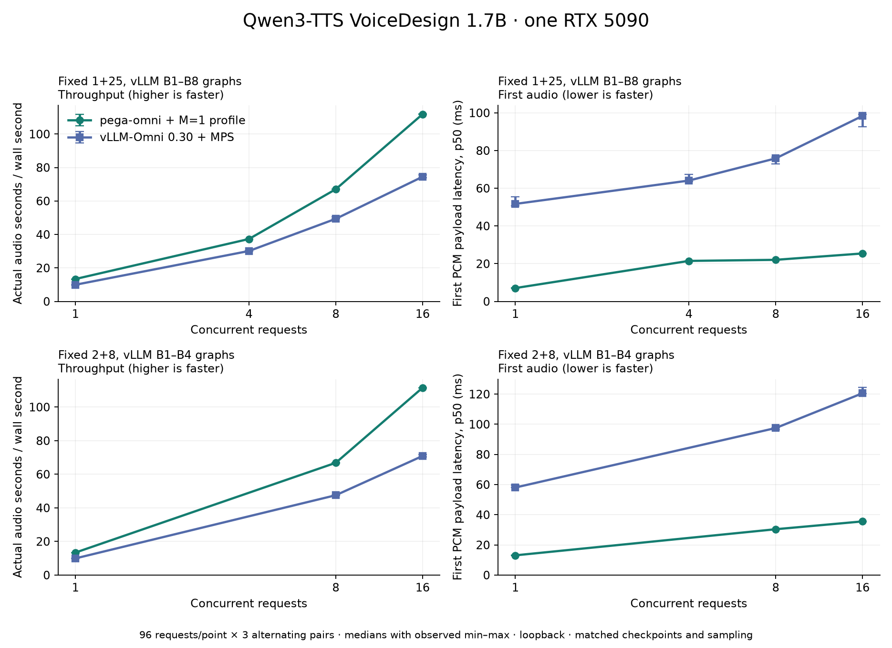

# Front-end benchmark against the simulated engine

**TL;DR** (2026-09-23): with one zero-cost engine loop the server sustains
~180k req/s and ~190k audio-s/s with zero failures up to 4096 concurrent
requests; the limiter is the single engine thread handing events to request
tasks, not the HTTP layer. Against a GPU-shaped paced engine the front end adds
no measurable TTFP over the engine floor and no playback underrun at 2048
concurrent streams. The one real bug found (no `TCP_NODELAY`, +40 ms per
packet) is fixed.

## Setup

- One node, 2x Grace (Neoverse-V2, 144 cores), otherwise idle. Server pinned to
  cores 0-31 with 32 tokio workers; `omni-bench` pinned to cores 36-71; loopback.
- Release build. Every run: warmup of `max(64, c)` requests to open connections,
  `--request-rate inf` unless stated, 0 failures unless stated.
- `tools/bench_sweep.sh <tag> <server args>` reproduces each row
  (env `CONCS`, `N`, `RATE`, `EXTRA`, `FORMAT`, `FRAMING`).

## 1. `TCP_NODELAY`

First run, 50k requests, `extra.frames = 13` (1.04 s audio, chunks 1+4+4+4):

| c | before req/s | before TTFP p50 | after req/s | after TTFP p50 |
|---|---:|---:|---:|---:|
| 64 | 1,564 | 41.0 ms | 173,127 | 0.16 ms |

Every packet waited for the client's delayed ACK (~40 ms) because axum does
not set `TCP_NODELAY` on accepted sockets. `omni_frontend::serve` now sets it.

## 2. Ceiling (zero-cost engine)

1M requests per point, 1.04 s audio each, PCM, raw audio framing:

| c | req/s | audio-s/s | TTFP p50 / p99 (ms) | E2E p50 / p99 (ms) | server cores |
|---:|---:|---:|---:|---:|---:|
| 16 | 161,536 | 167,998 | 0.08 / 0.13 | 0.09 / 0.15 | 6.5 |
| 64 | 179,349 | 186,523 | 0.16 / 0.32 | 0.37 / 0.62 | 10.7 |
| 256 | 178,733 | 185,882 | 0.34 / 1.02 | 1.39 / 3.01 | 12.2 |
| 1024 | 181,217 | 188,466 | 4.35 / 5.25 | 5.62 / 11.29 | 13.0 |
| 4096 | 180,217 | 187,426 | 21.7 / 24.8 | 23.0 / 45.0 | 14.8 |

Throughput is flat from c=64 and latency grows linearly after it (Little's
law): a serial stage saturates. `--no-metrics` in the same session gives
192k-201k req/s, so Prometheus recording costs 5-8% at the ceiling.

**Where the time goes.** Per-thread CPU at c=1024: `omni-sim` 1.01 cores
(saturated), tokio workers 15.5 cores over 32. pprof (`--features cpu-profile`)
on the engine thread: ~90% in atomics of the per-request channel send and task
wake (`compare_exchange`, `ldset`, `cas`, `wake_by_val`), 2.5% in the
scheduling core itself. The ceiling is one thread waking ~1.1M request tasks
per second. A real engine emits at 12.5 frames/s per stream, so this is about
88k concurrent real-time streams per engine loop at one-frame chunks, far past
what one GPU generates. Caching metric handles instead of the `counter!` macro
was tried and measured no different, so it did not land.

## 3. Real-time streams (paced engine)

Step cost `8 ms + 20 us x rows`, one-frame chunks, Poisson arrivals at
300 req/s (~580 streams running, ~20 ms steps), 7.7 s of audio per request,
40,960 requests:

| framing | TTFP p50 / p90 / p99 (ms) | underrun | server cores |
|---|---:|---:|---:|
| pcm, raw audio | 29.7 / 38.0 / 41.2 | 0 | 0.30 |
| wav, SSE | 29.5 / 37.8 / 41.0 | 0 | 0.43 |

The engine floor for a new request is the rest of the current step plus one
step, mean 1.5 steps = ~29 ms: the measured TTFP is the floor, so front-end
overhead is below resolution. No request stalled.

## Findings for the GPU engine

Same paced engine with a per-character prefill cost (`5 us/char`) and closed
loop at c=1024: admissions arrive in bursts, one step carries a burst's whole
prefill (~0.6 s), and every running stream waits for it. With one-frame first
chunks the average request stalls 237 ms; with four-frame first chunks the
320 ms buffer hides it. The GPU scheduler needs a prefill budget per step (or
a separate prefill lane) so admissions never stall running streams; the first
chunk size is a policy of that scheduler, not of the front end.

# Qwen3-TTS codec decoder kernels

**TL;DR** (2026-09-23, one GB300): one streamed codec frame for 64 requests
drops from 2.49 ms to 1.02 ms of GPU time, and from 0.77 ms to 0.40 ms for one
request. Measured at the server, at c=64 the step period falls from 13.1 ms to
8.3 ms and the engine serves 4x main's audio per second with every stream
continuous.

## Method

- **Codec alone.** Measured while the codec was still a kern runtime of its
  own (up to 2c556f1): one frame for B streams, 300 times, through its graph.
  The codec is now the tail of the model's `first` and `decode` graphs; to
  reproduce, run nsys with CUDA graph node tracing
  (`--cuda-graph-trace=node`) on a server under `omni-bench` at c=B and take
  each `decode` call's `codec_*` kernels. That gives the codec span per call
  (first codec kernel start to last kernel end) and each kernel's time.
  Under programmatic dependent launch a kernel's duration includes its wait
  on its producer, so each kernel is charged only its critical-path share:
  the part of its duration that no earlier kernel covers.
- **Server.** nsys on a live server under `omni-bench` load (default 2+8
  chunks) gives the step period: talker start to talker start.
- **A/B.** Same session, one server at a time on GPU 2. Server on cores
  108-125 and clients on 126-143, all on the GPU's NUMA node; the rest of the
  machine was idle apart from one job on another GPU. `main` is the chunked
  codec, which recomputes 72 frames of context per chunk. `opt` is the
  streamed kern codec with this work. Two tools:
  - `tools/qwen3_tts/vs_vllm_omni.sh bench`: vLLM-Omni's benchmark at
    c=1/8/16/64.
  - `omni-bench` at c=1/8/32/64: 4c requests (at least 64), warmup
    max(8, c).

  Zero failed requests everywhere.
- **Correctness.** The golden test streams the recorded codes at 36.57 dB SNR
  (36.58 dB before this work). Two streams of the same codes in one batch stay
  bit-identical, and a stream joining 7 frames late does too.

## Codec per frame

| | B=1 | B=64 |
|---|---:|---:|
| kernels per frame, before / after | 207 / 150 | 202 / 145 |
| span, before / after (µs) | 772 / 398 | 2489 / 1019 |

| step | B=1 span (µs) | B=64 span (µs) |
|---|---:|---:|
| streamed kern codec (start) | 772 | 2489 |
| attention applies RoPE and appends K/V itself; one block per (row, head) | 580 | 2312 |
| elementwise work fused into its neighbours, 8-wide loads; residual GEMMs accumulate in place | 487 | 1168 |
| SnakeBeta's sine: two-step range reduction plus `__sinf` | 478 | 1077 |
| programmatic dependent launch, weights loaded before the wait | 422 | 1045 |
| attention loads its K/V window while RoPE runs | 415 | 1037 |
| output conv and depthwise conv issue every tap's load in one round | 398 | 1019 |

Where B=64 went, in µs per frame:

| kernel(s) | before | after |
|---|---:|---:|
| bias + residual adds | 374 | 0 (folded into GEMM accumulate and epilogues) |
| im2col (+ SnakeBeta) | 313 + 150 | 201 |
| bias + SnakeBeta | 267 | 95 |
| attention (+ RoPE and K/V write) | 225 + 14 | 63 |
| output conv | 198 | 24 |
| overlap-add (col2im) | 174 | 30 |

About three quarters of the remaining B=64 time (755 of 1019 µs) is the four
upsampling blocks: the kernel-7 convs' GEMMs (~270 µs) and the im2col that
feeds them (~200 µs), which writes and the GEMM reads a column buffer seven
times the activation.

## Server

nsys under load, default 2+8 chunks. Before is an earlier capture, with the
same script, of the streamed kern codec without this work:

| c | codec span before / after | step period before / after |
|---:|---:|---:|
| 1 | 0.70 / 0.39 ms | 8.66 / 7.81 ms |
| 64 | 5.37 / 1.00 ms | 13.12 / 8.27 ms |

## A/B against main

The tables use these column conventions:

- TTFP is in ms, as p50 / p99.
- Continuity is vLLM-Omni's (underrun within 100 ms) for `vllm bench`, and the
  count of streams with no underrun over 1 ms for `omni-bench`.
- Underrun p99 is in ms.

`omni-bench`:

| c | build | TTFP | RTF p50 | audio-s/s | continuous | underrun p99 |
|---:|---|---:|---:|---:|---:|---:|
| 1 | main 2+8 | 12.1 / 14.0 | 0.075 | 13.3 | 64/64 | 0 |
| 1 | opt 2+8 | 12.2 / 12.4 | 0.075 | 13.3 | 64/64 | 0 |
| 8 | main 2+8 | 23.8 / 46.0 | 0.116 | 64.8 | 64/64 | 0 |
| 8 | opt 2+8 | 18.4 / 18.8 | 0.078 | 96.4 | 64/64 | 0 |
| 32 | main 2+8 | 43.4 / 134.5 | 0.258 | 116.8 | 67/128 | 43 |
| 32 | opt 2+8 | 20.5 / 20.9 | 0.087 | 320.9 | 128/128 | 0 |
| 64 | main 2+8 | 81.4 / 265.5 | 0.439 | 136.8 | 64/256 | 238 |
| 64 | opt 2+8 | 23.7 / 25.8 | 0.101 | 571.0 | 256/256 | 0 |
| 1 | main 1+25 | 6.7 / 6.8 | 0.072 | 13.9 | 0/64 | 59 |
| 1 | opt 1+25 | 6.3 / 6.4 | 0.075 | 13.3 | 0/64 | 68 |
| 8 | main 1+25 | 12.0 / 23.4 | 0.091 | 84.6 | 0/64 | 118 |
| 8 | opt 1+25 | 12.4 / 12.7 | 0.078 | 95.6 | 0/64 | 73 |
| 32 | main 1+25 | 19.7 / 42.5 | 0.154 | 191.8 | 0/128 | 307 |
| 32 | opt 1+25 | 13.7 / 14.0 | 0.087 | 331.7 | 0/128 | 92 |
| 64 | main 1+25 | 27.7 / 54.6 | 0.238 | 239.0 | 0/256 | 564 |
| 64 | opt 1+25 | 16.0 / 16.8 | 0.101 | 553.4 | 0/256 | 120 |

`vllm bench serve --omni`:

| c | build | TTFP | RTF p50 | audio-s/s | continuity |
|---:|---|---:|---:|---:|---:|
| 1 | main 2+8 | 13 / 13 | 0.075 | 13.3 | 100% |
| 1 | opt 2+8 | 13 / 13 | 0.075 | 13.3 | 100% |
| 8 | main 2+8 | 25 / 43 | 0.112 | 68.6 | 100% |
| 8 | opt 2+8 | 18 / 24 | 0.078 | 96.8 | 100% |
| 16 | main 2+8 | 31 / 62 | 0.157 | 98.1 | 100% |
| 16 | opt 2+8 | 19 / 32 | 0.082 | 179.3 | 100% |
| 64 | main 2+8 | 65 / 241 | 0.379 | 140.5 | 70% |
| 64 | opt 2+8 | 33 / 49 | 0.103 | 515.5 | 100% |
| 1 | main 1+25 | 7 / 7 | 0.072 | 13.8 | 100% |
| 1 | opt 1+25 | 7 / 7 | 0.075 | 13.3 | 100% |
| 8 | main 1+25 | 13 / 25 | 0.090 | 85.1 | 79% |
| 8 | opt 1+25 | 12 / 23 | 0.078 | 97.7 | 100% |
| 16 | main 1+25 | 17 / 35 | 0.111 | 134.2 | 13% |
| 16 | opt 1+25 | 13 / 27 | 0.082 | 186.7 | 100% |
| 64 | main 1+25 | 46 / 207 | 0.210 | 240.1 | 0% |
| 64 | opt 1+25 | 22 / 46 | 0.103 | 515.3 | 0% |

**Reading.**

- **c=1.** Both builds decode a frame well inside the talker's step, so they
  tie. main's 1+25 RTF is slightly lower because it decodes rarely.
- **Load.** Under load the step no longer grows with the codec:
  - At c=64, RTF stays at 0.10, against 0.21-0.44 for main.
  - Throughput is 2.1-4.2x main's.
  - p99 TTFP is 3-10x lower.
- **Underruns.** With 2+8 chunks no stream underruns up to c=64. The
  underruns left under 1+25 are the schedule's: after an 80 ms first chunk
  the next arrives 25 steps later.
- **Against the codec before this work.** An earlier session measured the
  streamed codec at c=64 on the same GPU, with its server on other cores:
  373 audio-s/s, RTF 0.156 and TTFP 37 ms under 2+8. This work lifts that to
  571 audio-s/s, RTF 0.10 and TTFP 24 ms.

## Tried, did not land

- **Fused transformer linear layers.** Tensor-core kernels with RMSNorm
  prologues and residual/SiLU epilogues, replacing the cuBLASLt GEMM plus
  norm/activation pairs. They cut 32 launches, but each kernel sat at about
  10 µs whatever its size (latency-bound), so the frame took 412 / 1145 µs
  against 398 / 1019.
- **Folding the RVQ output projection into the codebooks on the host.** At
  load this is 4.3 G MACs, too slow on the CPU. The GPU GEMM stays.
- **Chunking im2col and its GEMM so the column buffer stays in L2.** This
  needs `min`/`sub` in kern's shape expressions, which kern does not have.
- **An implicit-GEMM conv1 on mma.sync.** The estimate was about 80 µs at
  B=64, only for the last block, so it was not built.

# Qwen3-TTS: one manifest

**TL;DR** (2026-09-23, one GB300): the talker, code predictor, sampler and
streamed codec as one kern manifest, one graph launch per decode step, serve
1.27x main's audio per second at c=1 and 4.24x at c=64, with every stream
continuous at c=64 (main: 25%).

## Method

- main (3c4ad29) against this branch's release binary, one server at a time on
  GPU 2; server on cores 108-125, client (`omni-bench`) on 126-143, both on
  the GPU's NUMA node; order main, new, main, new; the table is the mean of
  the two runs.
- Default chunk schedule (2+8). Points c=1/8/32/64 with max(64, 4c) requests
  and max(8, c) warmups; prompts are 64 varied English and Chinese sentences.

## A/B against main

| c | TTFP p50 / p99 ms | RTF | audio-s/s | streams without underrun |
|---:|---|---|---|---|
| 1 | 12.2 / 14.7 → 9.9 / 16.4 | 0.075 → 0.059 | 13.3 → 16.8 (1.27x) | 128/128 → 128/128 |
| 8 | 23.9 / 46.5 → 19.6 / 29.4 | 0.116 → 0.069 | 65.4 → 111.5 (1.71x) | 128/128 → 128/128 |
| 32 | 42.3 / 147.9 → 21.2 / 29.6 | 0.252 → 0.084 | 116.7 → 327.7 (2.81x) | 158/256 → 256/256 |
| 64 | 80.4 / 278.8 → 22.5 / 32.6 | 0.442 → 0.099 | 133.0 → 563.6 (4.24x) | 128/512 → 512/512 |

Under nsys at c=1 each decode step is one `cuGraphLaunch` followed by two
copies back (codes and PCM); the only other launches are the eager prefills.

# PersonaPlex live sessions

**TL;DR** (2026-09-26): one GB300 runs **128 concurrent full-duplex
PersonaPlex-7B sessions** with zero playback underrun and zero late ticks;
frame lateness p99 is 12.6 ms and a tick takes 15 ms of its 80 ms. The ceiling
is session slots (memory), not time.

## Method

- One GB300 (tray, 4×GB300, aarch64; GPU 0 only), otherwise idle. Server
  pinned to cores 0-15, `omni-bench duplex` to cores 64-95, loopback.
- `pega-omni personaplex`, defaults otherwise (voice NATF2, the teacher
  role prompt): `--max-sessions 64` for levels up to 64, a fresh
  `--max-sessions 128` process for the rest.
- Each session streams the reference's 40 s test recording (a person asking
  about cooking rice, resampled to 24 kHz) at real time in 20 ms chunks for
  30 s; sessions start 20 ms apart. The model answers each one; the
  agent's audio and text are real, not forced.
- A level is clean when every session completed and no session's player
  (120 ms start-up buffer) stalled for more than 1 ms.

## Ramp

| sessions | clean | started p50 / p99 | late p50 / p99 / max | sessions with underrun |
|---:|:---:|---:|---:|---:|
| 1 | yes | 291 / 291 ms | 0.0 / 0.0 / 0.0 ms | 0 |
| 8 | yes | 68 / 109 ms | 0.0 / 2.0 / 4.1 ms | 0 |
| 16 | yes | 65 / 113 ms | 0.0 / 2.3 / 29.1 ms | 0 |
| 24 | yes | 63 / 110 ms | 1.3 / 2.7 / 27.9 ms | 0 |
| 32 | yes | 61 / 107 ms | 1.6 / 3.1 / 26.1 ms | 0 |
| 48 | yes | 60 / 106 ms | 2.2 / 4.1 / 24.9 ms | 0 |
| 64 | yes | 58 / 111 ms | 3.9 / 7.3 / 34.3 ms | 0 |
| 80 | yes | 64 / 318 ms | 1.9 / 8.0 / 25.9 ms | 0 |
| 96 | yes | 59 / 103 ms | 4.6 / 9.1 / 18.5 ms | 0 |
| 112 | yes | 54 / 85 ms | 5.5 / 10.2 / 20.4 ms | 0 |
| 128 | yes | 44 / 84 ms | 6.8 / 12.6 / 13.1 ms | 0 |

`omni_engine_late_ticks_total` was 0 after the 80-128 run. "Started" is
connect to `session.started`: waiting for the tick boundary plus the prompt
prefill; the first level of each process (1 and 80) also pays graph captures.
"Late" is how far behind its timeline slot a frame arrived, relative to the
session's first frame.

Tick time (the GPU call as the engine sees it), from the engine's debug log:

| sessions | 1 | 8 | 32 | 64 | 128 |
|---|---:|---:|---:|---:|---:|
| p50 | 8.1 ms | 8.0 ms | 8.6 ms | 11.0 ms | 15.0 ms |
| p99 | 10.0 ms | 8.5 ms | 9.3 ms | 11.8 ms | 15.9 ms |

The first tick of each new bucket includes its graph capture (up to 41 ms,
once per bucket per process).

# Qwen3-TTS VoiceDesign on RTX 5090

This section reports one measured deployment of Qwen3-TTS-12Hz-1.7B-VoiceDesign on one RTX 5090. Results are conditional on this checkpoint, workload, hardware, runtime pins, and deployment settings. Measured on 2026-10-27; exact run-level evidence is in [the result record](benchmarks/voicedesign-rtx5090-20261027.json.gz).

## Hardware, software, and source

- One RTX 5090, 32,607 MiB reported VRAM; driver 595.71.05; nvcc 13.0.88.
- Container memory 90 GiB; CPU quota equivalent to 25 CPUs, rather than 25 dedicated physical cores.
- GPU NUMA node 1; disjoint logical CPU sets: server 52–67, client 68–71, controller 48–51.
- Pega source `0f3889a924d6f0e00b3ef7a92e7e79718c7bf2f3`; production binary SHA256 `0dc08989064a930047dcfd9f45bd164c6095f69b84f9461db7dad8d180523891`.
- Published stable vLLM 0.30.0 and vLLM-Omni 0.30.0, Omni tag commit `a8576ccb725c4e21cd13c3eb5f9a546b21149d2b`; serving PyTorch `2.13.0+cu130`.
- Model `Qwen/Qwen3-TTS-12Hz-1.7B-VoiceDesign`, HF revision `5ecdb67327fd37bb2e042aab12ff7391903235d3`. Both engines read identical checkpoint files, verified against HF/LFS hashes.
- Official Qwen3-TTS correctness reference source `022e286b98fbec7e1e916cb940cdf532cd9f488e` uses PyTorch `2.11.0+cu130`. Runtime implementations and toolchains are therefore not identical.

## Workload and matched settings

The primary timed workload contains all 30 English VoiceDesign rows from the [stable vLLM-Omni dataset](https://github.com/vllm-project/vllm-omni/blob/a8576ccb725c4e21cd13c3eb5f9a546b21149d2b/benchmarks/build_dataset/seed_tts_design/en/meta.lst). Target text and voice description become the input and instructions. Each point repeats the same ordered cases to form 96 requests; these are 30 source examples, not 96 independent prompts. Both engines receive identical input, instructions, language, numeric seeds, and per-row caps. The expanded workload digest is `739f13b01fe67e439fd532bfb269ee008e839d30f08e599469ee9195bb69e732`.

Main-talker sampling is temperature 0.9, top-p 1.0, top-k 50, repetition penalty 1.05. The residual-code predictor uses temperature 0.9, top-p 1.0, top-k 50, with no repetition penalty. EOS requires at least two codec frames. The shared cap is `min(50 + 6 * Unicode_codepoint_count(input), 8192)`; vLLM receives it explicitly and Pega applies the same rule internally. Equal numeric seeds do not imply identical RNG streams, tokens, or audio between runtimes or batch sizes.

The primary schedule is fixed at one initial codec frame followed by 25-frame chunks. vLLM adaptive chunking is disabled and left context is 72 frames. Pega uses its continuous stateful codec. vLLM requests set `task_type=VoiceDesign`, `non_streaming_mode=true`, and initial chunk 1; the HTTP response still streams raw mono 24 kHz signed-16-bit little-endian PCM.

Pega uses maximum batch 16, step-token budget 2,048, KV budget 4 GiB, and the recorded RTX 5090 M=1 GEMM profile. The vLLM profile inherits the stable single-GPU B1–B8 codec graph configuration, uses talker `max_num_seqs=64` and codec `max_num_seqs=32`, and enables a private experiment-owned MPS daemon. These are measured deployment configurations; scheduler and memory reservations differ internally.

## Baseline profile screening

Each screen point used 12 requests from six mixed English/Chinese cases repeated twice, seed 42; all points completed 12/12. The screen differs from the formal 30-example workload and is not pooled into it.

| Profile | c1 first-audio p50 ms | c1 audio s/s | c8 first-audio p50 ms | c8 audio s/s |
| --- | ---: | ---: | ---: | ---: |
| Default, MPS disabled | 56.07 | 11.20 | 151.62 | 40.12 |
| B1–B8 throughput, MPS disabled | 52.16 | 11.22 | 142.01 | 41.44 |
| B1–B8 throughput, private MPS enabled | 48.52 | 10.79 | 147.68 | 42.09 |

The throughput/MPS profile was selected for the formal run. MPS improved the screened c1 median first-audio latency and c8 throughput, while MPS-off had higher c1 throughput and lower c8 median first-audio latency. It was not best on every metric, and the short screen does not establish statistical significance.

## Primary fixed 1+25 results

Each engine ran alone on the GPU. Three repetitions alternate Pega→vLLM, vLLM→Pega, Pega→vLLM. Each repetition measures concurrency 1, 4, 8, and 16 with 96 timed requests per point, preceded by `max(4, concurrency)` excluded warmups. All 24 planned points are valid: 2,304/2,304 timed requests completed with zero recorded warmup or timed-request failures and no missing request records.

Every cell below is the median of three run-level estimates followed by its observed [minimum, maximum]. A run-level p99 remains the percentile of that run's 96 requests, not a percentile pooled across repetitions. These same-session ranges are descriptive variation, not confidence intervals.

| Engine | c | Audio s/s | First audio p50 ms | First audio p99 ms | Mean audio s |
| --- | --- | --- | --- | --- | --- |
| Pega-Omni | 1 | 13.390 [13.373, 13.391] | 7.08 [7.06, 7.23] | 7.66 [7.42, 7.74] | 4.428 [4.428, 4.428] |
| Pega-Omni | 4 | 37.302 [37.288, 37.306] | 21.48 [21.46, 21.49] | 28.05 [28.02, 28.05] | 4.419 [4.419, 4.419] |
| Pega-Omni | 8 | 67.036 [66.937, 67.060] | 22.05 [22.04, 22.09] | 28.70 [28.68, 28.73] | 4.473 [4.473, 4.473] |
| Pega-Omni | 16 | 111.850 [111.841, 111.977] | 25.43 [25.30, 25.49] | 34.38 [34.29, 34.55] | 4.512 [4.512, 4.512] |
| vLLM-Omni | 1 | 9.956 [9.880, 9.974] | 51.70 [50.67, 55.58] | 60.20 [56.80, 62.03] | 4.436 [4.436, 4.436] |
| vLLM-Omni | 4 | 30.131 [30.064, 30.441] | 64.09 [63.51, 67.41] | 100.18 [94.66, 115.19] | 4.472 [4.442, 4.496] |
| vLLM-Omni | 8 | 49.357 [49.283, 50.624] | 75.85 [72.86, 76.41] | 152.50 [142.40, 157.55] | 4.467 [4.460, 4.510] |
| vLLM-Omni | 16 | 74.470 [73.778, 75.665] | 98.36 [92.57, 99.30] | 223.10 [222.23, 224.20] | 4.489 [4.478, 4.505] |

| Engine | c | E2E p50 ms | E2E p99 ms | RTF p50 | Underrun p99 ms |
| --- | --- | --- | --- | --- | --- |
| Pega-Omni | 1 | 322.65 [322.31, 323.60] | 487.23 [486.72, 487.46] | 0.0747 [0.0747, 0.0747] | 66.65 [66.52, 67.60] |
| Pega-Omni | 4 | 460.02 [459.80, 460.04] | 688.63 [687.93, 689.90] | 0.1054 [0.1054, 0.1054] | 131.72 [131.47, 131.87] |
| Pega-Omni | 8 | 491.99 [491.76, 492.89] | 763.97 [763.46, 765.83] | 0.1142 [0.1142, 0.1144] | 157.41 [156.70, 157.56] |
| Pega-Omni | 16 | 571.17 [571.09, 571.32] | 940.89 [940.56, 940.97] | 0.1353 [0.1352, 0.1353] | 212.88 [212.50, 213.54] |
| vLLM-Omni | 1 | 438.57 [435.46, 439.33] | 622.44 [622.12, 628.55] | 0.1004 [0.1001, 0.1013] | 109.43 [108.57, 111.67] |
| vLLM-Omni | 4 | 578.83 [576.73, 586.76] | 892.15 [889.53, 903.32] | 0.1316 [0.1306, 0.1323] | 170.98 [167.86, 172.82] |
| vLLM-Omni | 8 | 689.97 [671.24, 717.29] | 1051.24 [1041.13, 1097.34] | 0.1578 [0.1542, 0.1584] | 237.09 [217.54, 237.61] |
| vLLM-Omni | 16 | 884.22 [847.89, 885.77] | 1360.81 [1337.73, 1407.54] | 0.2014 [0.2000, 0.2030] | 332.18 [330.13, 342.25] |

| Engine | c | Underrun >1 ms fraction | Underrun >100 ms fraction | Peak GPU MiB | Startup s |
| --- | --- | --- | --- | --- | --- |
| Pega-Omni | 1 | 1.000 [1.000, 1.000] | 0.000 [0.000, 0.000] | 10138 [10138, 10138] | 11.01 [11.01, 11.03] |
| Pega-Omni | 4 | 1.000 [1.000, 1.000] | 1.000 [1.000, 1.000] | 10150 [10150, 10150] | 11.01 [11.01, 11.03] |
| Pega-Omni | 8 | 1.000 [1.000, 1.000] | 1.000 [1.000, 1.000] | 10160 [10160, 10160] | 11.01 [11.01, 11.03] |
| Pega-Omni | 16 | 1.000 [1.000, 1.000] | 1.000 [1.000, 1.000] | 10174 [10174, 10174] | 11.01 [11.01, 11.03] |
| vLLM-Omni | 1 | 1.000 [1.000, 1.000] | 0.552 [0.552, 0.646] | 23216 [23216, 23216] | 64.05 [63.04, 66.05] |
| vLLM-Omni | 4 | 1.000 [1.000, 1.000] | 1.000 [1.000, 1.000] | 23220 [23220, 23220] | 64.05 [63.04, 66.05] |
| vLLM-Omni | 8 | 1.000 [1.000, 1.000] | 1.000 [1.000, 1.000] | 23220 [23220, 23222] | 64.05 [63.04, 66.05] |
| vLLM-Omni | 16 | 1.000 [1.000, 1.000] | 1.000 [1.000, 1.000] | 23224 [23222, 23224] | 64.05 [63.04, 66.05] |

Paired ratios are calculated within each repetition before taking their median; they are not ratios of independently rounded table medians.

| c | Pega/vLLM audio throughput | Pega/vLLM first-audio p50 | Pega/vLLM mean duration |
| --- | --- | --- | --- |
| 1 | 1.345 [1.343, 1.353] | 0.137 [0.130, 0.140] | 0.998 [0.998, 0.998] |
| 4 | 1.238 [1.226, 1.241] | 0.335 [0.319, 0.338] | 0.988 [0.983, 0.995] |
| 8 | 1.358 [1.322, 1.361] | 0.291 [0.288, 0.303] | 1.001 [0.992, 1.003] |
| 16 | 1.504 [1.478, 1.516] | 0.259 [0.255, 0.275] | 1.005 [1.001, 1.008] |

On this workload and configuration, paired median Pega/vLLM audio-throughput ratios range from 1.238 to 1.504. First-audio and end-to-end latencies are lower in the measured Pega runs. This is an observation for this deployment, not a claim across models, hardware, vLLM versions, or workloads.

Mean audio durations are close in this comparison: paired Pega/vLLM ratios span 0.983–1.008 across all runs and concurrencies. Duration comparability does not by itself prove complete transcription, style adherence, or perceptual quality; the separate audio checks below remain necessary.

## Measurement definitions and limits

- First-audio latency ends at the first nonempty PCM payload, not HTTP headers. E2E ends after successful completion of the response body.
- Audio duration comes from completed PCM bytes divided by `24000 * 2`. Audio throughput is total successfully completed emitted audio seconds divided by the measured request-phase wall time. RTF is request E2E seconds divided by emitted audio seconds.
- Failed or interrupted streams are counted as failures; partial audio does not enter successful-request distributions or throughput. All current primary points have zero recorded failures. Transport read chunks need not equal codec frames.
- Underrun is a cumulative-arrival playback model starting at first audio with zero initial playback buffer. It is not a physical-player measurement. All primary requests exceed 1 ms modeled underrun; at c≥4 all exceed 100 ms despite RTF below one. A small first chunk can expose a later gap even when total generation is fast.
- GPU memory is polled device-total usage within each client phase, including warmup; startup is measured separately. Polling is at one-second intervals and can miss short peaks. Reservation policies differ, so these values describe whole deployments, not intrinsic per-token memory efficiency.
- Startup is launch to `/health` with compiled caches retained, not a cold-start comparison. Initial startup and warmup requests are outside the timed phase. Pega captures graphs lazily: some batch/admission shapes first appear during measurement, so their capture cost remains in the reported request timings. Readiness and these warmups do not guarantee all graphs are captured.
- Captured PCM is written in separate calls outside the timed phase. Seeds do not force RNG identity. Durations and cap margins are retained for inspection.
- No clock locking or isolation from other physical-host tenants is claimed. Temperature, power, and SM clocks are retained as descriptive telemetry. Empty compute-process lists, rather than the driver's anomalous idle utilization reading, gate engine handoff.
- Three repetitions on one rented host do not establish significance or portability. The 96-request p99 values and preliminary profile choices have limited sample size.

## Separate internal Pega optimization study

The repository-required `omni-bench` study compares the preceding Pega implementation with the production M=1 GEMM profile. It uses a uniform voice instruction and controlled prompts, so its results must remain separate from the per-case VoiceDesign framework comparison. There are three alternating paired repetitions, 96 requests per point at c1 and c4; all 12 points are valid with no recorded failures.

| c | Candidate/baseline audio throughput | Candidate/baseline mean duration | Candidate/baseline first-audio p50 |
| --- | --- | --- | --- |
| 1 | 1.02321 [1.02315, 1.02339] | 0.94490 [0.94490, 0.94490] | 0.98243 [0.97360, 0.98874] |
| 4 | 1.00029 [0.99840, 1.00830] | 0.99109 [0.99081, 0.99120] | 0.99486 [0.99413, 0.99632] |

The paired c1 throughput increase is 2.32% (observed 2.315–2.339%). At c4 the paired median change is only +0.029%, with a range of −0.160% to +0.830%; no material c4 throughput gain is established. The median c1 E2E latency is 1.624% higher. The candidate's mean output is about 5.51% shorter at c1 and 0.89% shorter at c4, so even duration-normalized throughput should not be presented as a pure fixed-token kernel speedup. This small local optimization does not explain the whole cross-engine difference.

## Numerical correctness and free-running audio

The production profile passes the unchanged tokenizer, embedding, teacher-forced
logit and 30 dB waveform gates against the pinned official implementation.
Each test replays one stream and then three interleaved streams sequentially.

| Case | Frames | Single-stream SNR dB | Worst three-stream SNR dB |
|---|---:|---:|---:|
| VoiceDesign English | 73 | 34.36 | 33.71 |
| VoiceDesign Chinese | 93 | 32.37 | 32.42 |
| VoiceDesign long English | 366 | 33.14 | 33.04 |
| CustomVoice English | 75 | 36.02 | 36.09 |

The recorder now calls the official codec decoder continuously. Its public
wrapper resets context every 300 frames with 25 frames of overlap; comparing
that wrapper with the continuous Rust codec gave a misleading 29.13 dB long
result. The original failed recording is preserved. Re-decoding the same
recorded codes continuously fixes the reference mismatch without changing
any tolerance or production codec kernel.

All 2,304 primary outputs contain complete codec frames and none reaches the
configured generation cap (minimum margin: 235 frames). This excludes that
specific truncation mechanism, not every possible semantic omission. Across
30 cases, mean pega/vLLM duration ratios range from 0.910 to 1.106; individual
stochastic request pairs vary more widely.

Whisper small multilingual transcribed the final six short/medium/long English
and Chinese clips per engine, without seeing expected text as a prompt. Both
engines have English WER 0/78 words. Pega has Chinese CER 0/188 characters;
vLLM has 6/188 character substitutions (3.19%), all traditional/simplified
variants in the short sentence, with no deletions or insertions. All twelve
clips complete ASR successfully. This is an intelligibility spot check, not
subjective naturalness, speaker similarity, instruction adherence, or proof
of quality across all thirty timed examples.

## CustomVoice regression

A separate same-session `omni-bench` comparison uses the archived upstream
base `dfdd530e7e4c6515d6934faeb2c25ed80b03d720` and production with default
heuristics, `ryan`, identical CustomVoice checkpoint files, uniform English
instructions, 96 requests at c1/c4 and three alternating pairs. All 1,152
requests succeed. Paired production/base audio-throughput ratios are
1.00040 [0.99980, 1.00066] at c1 and 1.00765 [1.00525, 1.00808] at c4;
mean-duration ratios are 1.00000 and 1.00477. No material c1 regression is
observed. This compatibility check is separate from the VoiceDesign study.

## Fixed 2+8 deployment comparison

Both engines use a fixed two-frame first chunk and eight-frame subsequent
chunks. All 1,728 requests across three alternating pairs at c1/c8/c16 succeed;
all streams have zero modeled underrun at every point. Both engines therefore
have 100% continuity under the same zero-initial-buffer playback model.

The initial vLLM B1–B8 configuration ran out of GPU memory in codec graph
capture and failed 94 measured requests. That attempt is preserved and excluded
from speed ratios. The successful rerun limits only codec decoder batch size
and graph buckets to B1–B4; c16 requests are still admitted and decoded in
microbatches. Model, sampling, generation limits, talker allocation and chunk
schedule remain the same. No upstream vLLM model code is patched. This is a
separate memory-fit deployment, not the primary B1–B8 baseline.

| Engine | c | Audio s/s | First audio p50 ms | First audio p99 ms | RTF p50 | Continuous streams | Peak GPU MiB |
|---|---:|---|---|---|---|---:|---|
| pega | 1 | 13.39 [13.38, 13.40] | 13.08 [13.07, 13.21] | 14.35 [13.53, 14.40] | 0.0747 [0.0747, 0.0748] | 100% | 10138 [10138, 10138] |
| pega | 8 | 66.82 [66.74, 66.89] | 30.39 [30.36, 30.41] | 37.91 [37.90, 38.97] | 0.1145 [0.1144, 0.1148] | 100% | 10158 [10158, 10158] |
| pega | 16 | 111.51 [111.47, 111.58] | 35.57 [35.48, 35.62] | 46.96 [46.70, 47.06] | 0.1357 [0.1356, 0.1358] | 100% | 10168 [10168, 10168] |
| vllm | 1 | 9.92 [9.89, 9.93] | 58.05 [58.02, 59.60] | 69.08 [68.91, 70.43] | 0.1008 [0.1008, 0.1014] | 100% | 26254 [26254, 26254] |
| vllm | 8 | 47.53 [47.24, 47.67] | 97.51 [96.23, 97.58] | 175.33 [166.51, 181.05] | 0.1643 [0.1628, 0.1644] | 100% | 26260 [26258, 26260] |
| vllm | 16 | 70.88 [70.26, 71.69] | 120.56 [120.37, 124.40] | 248.13 [242.36, 265.57] | 0.2142 [0.2118, 0.2143] | 100% | 26262 [26262, 26262] |

Paired median pega/vLLM audio-throughput ratios are 1.349 [1.349, 1.354] at c1,
1.407 [1.400, 1.415] at c8 and 1.573 [1.555, 1.588] at c16. Mean-duration
ratios are 0.989, 1.009 and 1.005. All 1,728 outputs are frame-aligned and below
their generation caps (minimum margin: 248 frames). Pega's 2+8 configuration
trades a larger first chunk for continuous playback while retaining nearly the
same throughput as its 1+25 configuration; the raw data records both schedules.

## Reproduction and evidence

Use [the runbook](voicedesign-benchmark.md) and
`tools/qwen3_tts/bench_voicedesign.py` with the recorded ordered workload,
server commands, profiles, CPU affinity and sampling. The benchmark record
contains run-level estimates, individual-result hashes, numerical and ASR
summaries, paired ratios and deployment identities. Full per-request
arrival traces, PCM, telemetry, logs and dependency freezes are preserved in
the experiment archive. Re-run correctness and timing on a different GPU or
cuBLASLt version; the optional algorithm file refuses mismatched identities.

The result record is gzip-compressed JSON; inspect it with
`gzip -dc docs/benchmarks/voicedesign-rtx5090-20261027.json.gz` from the repository root.

## Extended single-row GEMM profile

Run-level data, frozen profiles, numerical/quality audits and source hashes
are in [the extension record](benchmarks/voicedesign-rtx5090-extension-20261027.json.gz).

A second same-session `omni-bench` study on the same RTX 5090 compares the
original four-entry profile with nine entries, using the same production
binary (`0dc08989...523891`). Both arms explicitly load their profile and use
batch 16, step-token budget 2,048, KV 4 GiB and fixed 1+25 chunks. The 30 official
English texts receive one identical voice instruction and generation seed 42
per request. There are 96 requests per point and three alternating pairs;
all 1,152 measured requests succeed. This comparison has a uniform instruction
and a different baseline from the cross-engine studies above.

| c | Original 4 audio s/s | Extended 9 audio s/s | Paired throughput ratio [min,max] | Paired p50 RTF ratio | Mean audio-duration ratio |
|---:|---:|---:|---:|---:|---:|
| 1 | 13.400 | 13.951 | 1.04110 [1.03934,1.04178] | 0.960 | 1.01385 |
| 4 | 37.431 | 37.129 | 0.99343 [0.99193,1.00335] | 1.000 | 1.01073 |

The c1 serving throughput gain is present in every observed pair. c4 is
approximately flat with a median -0.66% and range -0.81% to +0.34%; there is no
measured c4 improvement. Free-running output lengths differ: c1 per-case mean
duration ratios span 0.766–1.235. Actual audio seconds and RTF normalize for
length, but this serving study does not fix generated frames.

An independent public-`Model`-API replay fixes the official 73-frame English
and 366-frame continuous codes, their final EOS calls and audio bytes. Three
profiles run in rotating order over three rounds after two complete warmups
per profile/case/mode. Loads, graph warmups, hashing and scoring are outside
timing; measured replay includes prefill, decode, D2H and the engine's s16 PCM
conversion. All 36 timed replays complete and reproduce the same per-stream
PCM hashes across the profiles.

| Forced golden | Streams | Original 4 wall ms | Extended 9 wall ms | Paired speed ratio |
|---|---:|---:|---:|---:|
| English, 73 frames | 1 | 431.259 | 411.271 | 1.04860 [1.04790,1.04939] |
| Continuous, 366 frames | 1 | 2237.509 | 2138.675 | 1.04621 [1.04570,1.04678] |
| English, 73 frames | 3 | 614.809 | 613.587 | 1.00199 |
| Continuous, 366 frames | 3 | 2974.693 | 2976.360 | 0.99944 |

Wall times are means; paired speed ratios are geometric means of
original/candidate time over three rounds. Ranges describe the observed
rounds. This fixed-work result supports a single-stream runtime improvement;
three streams are flat. Its small equal pools and three simultaneously
resident models differ from serving admission and HTTP. The sampled 18,240 MiB
device peak belongs to those three resident models and is not production
single-instance memory.

Both candidate extensions pass all four existing configured golden cases,
each single-stream and interleaved three-stream, with unchanged embedding,
logit and >30 dB waveform gates. To check the changed free-generation lengths,
both profiles independently capture all 30 exact serving texts with the same
uniform instruction and per-request seed 42. Every case reproduces its formal
c1 duration within 1e-8 s. Blind Whisper-small transcription yields 7/352 word
errors for each profile, with different flagged cases; the two cases with the
largest relative length changes transcribe without errors in both arms. This observes
no aggregate ASR regression on these inputs. Perceptual voice quality and
instruction adherence remain unmeasured.

The opt-in
`tools/qwen3_tts/profiles/rtx-5090-cublaslt-130101-m1-extended.json` preserves
the original four algorithms and adds five shapes. Its numeric device and
algorithm payload equals the measured nine-entry file; only descriptive
annotations were updated after validation. The original four-entry file
stays unchanged. Runtime source, default heuristic selection and M>=2
operations are unchanged by this profile extension.
